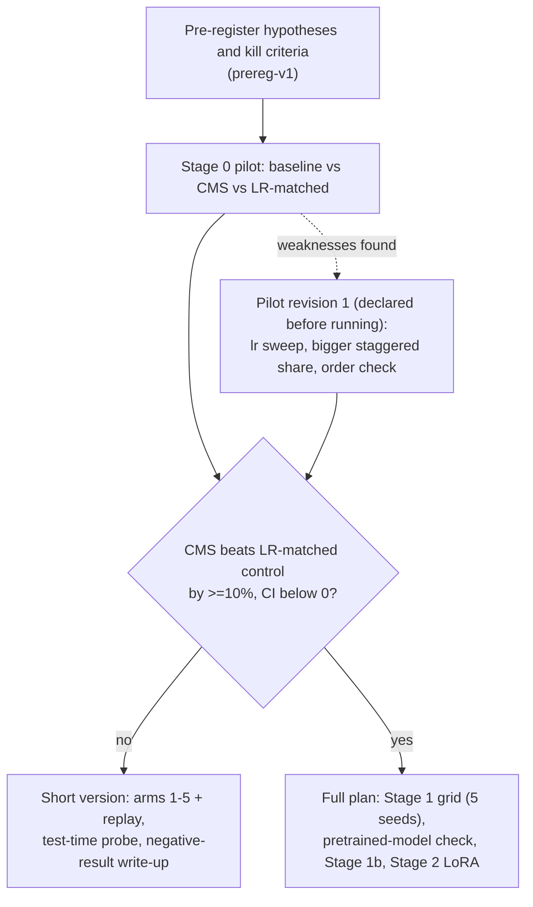
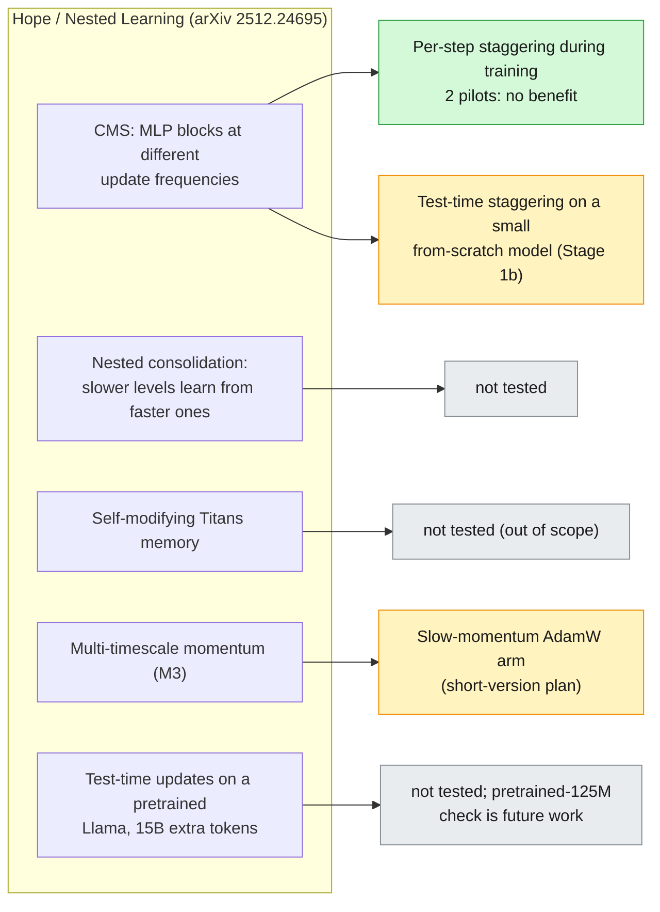
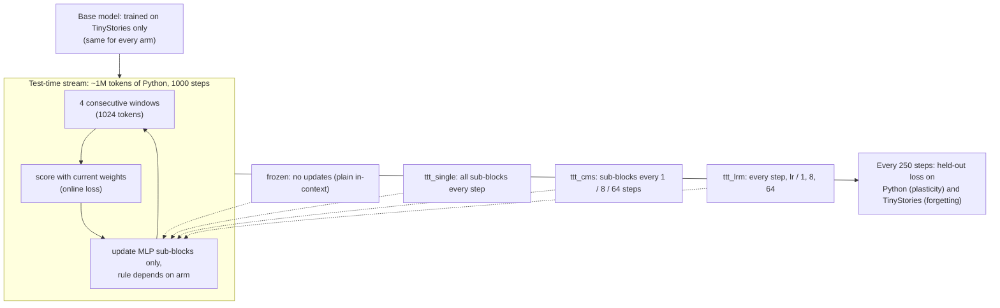

# catadye: does update-frequency staggering reduce catastrophic forgetting?

Controlled study of one component of Google's Nested Learning / Hope architecture
(arXiv 2512.24695): CMS-style MLP blocks that update at different frequencies, tested in a plain
small transformer. Negative results will be reported as readily as positive ones.

**Scope caveat.** In the paper, CMS frequencies count tokens in the context stream and blocks update
at test time on Llama3 backbones after 15B tokens of extra pre-training. The main study here
staggers updates per *optimizer step* during training ("CMS-inspired"). It neither confirms nor
refutes the paper's claims. A toy-scale paper-style probe (Stage 1b) is exploratory and reported
separately.

## Status

| Stage | State |
|---|---|
| Literature check, plan, pre-registration | done (`prereg-v1`) |
| Stage 0 pilot (16.1M params) | done, **negative**: CMS did not reduce forgetting |
| Pilot revision 1 (bigger staggered share, lr sweep, order check) | done (`prereg-pilot-rev1`), **negative again**: gate says short version |
| Stage 1b test-time probe | declared (`prereg-stage1b`), base models training, then 30 runs |
| Post-hoc diagnostics (where does forgetting live?) | queued behind the base models (exploratory, not pre-registered) |
| Stage 1 main grid, Stage 2 LoRA | not started |

## What is being tested

Nested Learning's Continuum Memory System (CMS) chains MLP blocks that update at different
frequencies. This repo asks whether *update-frequency staggering alone* reduces forgetting when a
plain transformer is trained on a sequence of domains. Every arm has the same architecture, so
parameters and forward FLOPs are identical; arms differ only in *how each sub-block is updated*.


The **LR-matched control** is the key comparison. Under AdamW, updating a block every *k* steps moves it
roughly 1/*k* as far as updating it every step, so a CMS gain could just be a smaller learning rate.
The control uses the same blocks at `lr/k`, updated every step.

## Study flow



## How forgetting is measured

Each model trains on domain 1 and then domain 2; after each domain it is evaluated on both. The
**forgetting** number is how much the domain-1 loss rises after training on domain 2 (positive =
forgetting; lower is better).


Slower learning forgets less but also learns the new domain less, so arms are only compared at the
same **plasticity** (new-domain loss). Each arm is run at 3 learning rates, which traces a
stability-plasticity line; forgetting is then read off each line at a common new-domain loss. The
pre-registered test does this per seed with bootstrap CIs.


## What this repo tests, and what it does not

Hope has several parts. Colour shows what is covered here: green = tested, amber = planned or
running, grey = not tested (so nothing here supports or refutes it).



## Stage 1b at a glance (test-time probe)



## Results so far

Pilot 1 (16.1M params, TinyStories then Python, 3 seeds). Forgetting is the rise in TinyStories
eval loss after training on code; plasticity (new-domain loss) is matched across arms.


Revised pilot (24.0M params, staggered sub-blocks = 39% of parameters, 3 learning rates, 3 seeds).
At every learning rate CMS learns the new domain slightly better *and* forgets slightly more, so
the arms trace the same stability-plasticity line; at matched plasticity there is no detectable
difference. Reversing the domain order gives the same picture.


| Forgetting at matched new-domain loss (2.79), nats | mean ± sd | difference vs baseline [95% CI] |
|---|---|---|
| baseline | 3.592 ± 0.163 | |
| CMS 1/8/64 | 3.678 ± 0.060 | +0.085 [-0.169, +0.252] |
| LR-matched control | 3.567 ± 0.049 | -0.025 [-0.156, +0.085] |

CMS vs LR-matched: +0.111 [-0.013, +0.179]. Pre-registered criteria (a) and (b) both fail, so the
gate selects the short version of the plan. Order B (lr 6e-4): baseline 4.90 ± 0.17, CMS 5.14 ± 0.20,
LR-matched 5.20 ± 0.07 (n=3 each; not used in the gate).

**Reading:** per-step update-frequency staggering is indistinguishable from a smaller learning
rate and gives no forgetting benefit here. This does not test Hope's test-time CMS on a pretrained
model, its nested consolidation between levels, the self-modifying memory, or multi-timescale
momentum.

Details, caveats and the full tables are in the [Results log](#results-log) below. Figures are
regenerated from the raw run files in `results/` by `python scripts/make_figures.py`.

## Reproduce

```bash
python -m venv .venv && .venv/Scripts/pip install torch --index-url https://download.pytorch.org/whl/cu124
.venv/Scripts/pip install numpy tiktoken pyyaml scipy matplotlib pytest
.venv/Scripts/python -m pytest                      # unit tests
.venv/Scripts/python scripts/run_pilot.py           # pilot 1 (9 runs, ~70 min on an RTX 3050 4 GB)
.venv/Scripts/python scripts/run_pilot_rev.py       # revised pilot (36 runs)
.venv/Scripts/python scripts/analyze_pilot.py       # pre-registered readout
.venv/Scripts/python scripts/make_figures.py        # figures/
```

Data is streamed over HTTP on first use and cached in `data/` (git-ignored).

---

## Pre-registration (written before any experiment is run)

Status: PRE-REGISTERED. Changes after the first run go in the Deviations log at the bottom, with
a date and reason; the original text is never edited.

### Hypotheses
- **H1** CMS (periods 1/8/64) reduces forgetting versus the baseline at matched plasticity.
- **H2** CMS reduces forgetting versus the LR-matched control (blocks at lr, lr/8, lr/64 updated
  every step). This separates "update frequency" from "smaller effective step".
- **H3** Slow-momentum AdamW reduces forgetting versus plain AdamW.
- **H4** CMS and slow momentum interact (2x2 interaction term differs from zero).

### Primary metric
Forgetting at matched plasticity. For each arm, sweep the shared learning rate scale on domain 1
only; compare arms at equal new-domain (final-domain) eval loss, via the stability-plasticity
frontier (mean loss increase on earlier domains versus new-domain loss). Secondary: loss matrix
R[i,j] (domain j after training on i), backward transfer, forward transfer, final average loss.
Cost: wall-clock, peak VRAM, tokens/s.

### Minimum effect of interest
A 10% relative reduction in mean earlier-domain loss increase, with the 95% CI excluding 0 and
new-domain loss no more than 2% worse. Smaller differences are reported as "no practical effect".

### Statistics
Seed-paired differences, bootstrap 95% CIs (10,000 resamples), Holm correction across the planned
comparisons H1-H4. A difference whose CI includes 0 is called "within noise".

### Matching
Every arm has identical parameter count and forward FLOPs (each MLP is a 3-block chain in every
arm). Update overhead is reported honestly. Learning rates come from a pre-declared sweep on domain
1 only; nothing is tuned on forgetting metrics.

### Stage 0 pilot and kill criteria
~10M-param GPT, TinyStories then Python code, 3 arms (baseline, CMS 1/8/64, LR-matched), 3 seeds.
The "frequency per se" hypothesis is falsified at pilot scale if (a) CMS does not reduce
domain-1 loss increase versus baseline at matched domain-2 loss, or (b) CMS is within seed noise of
the LR-matched control. The study continues either way, framed around whichever outcome holds.

**Decision gate:** if CMS differs from the LR-matched control beyond seed noise, run the full plan
(Stage 1 grid, Model B check, Stage 1b probe). Otherwise run the short version (arms 1-5 plus
replay, Stage 1b, a negative-result write-up) and skip Stage 2.

### Arms (Stage 1)
1 baseline; 2 CMS 1/8/64; 3 slow-momentum AdamW; 4 CMS + slow momentum; 5 LR-matched control;
6 replay 10%; 7 EWC; 8 joint training (upper bound); 9 in-context-learning baseline (eval only).

## Layout
`src/catadye` library, `configs/` per-arm YAML, `scripts/` runners and analysis, `tests/`,
`results/` raw per-run JSONL (not edited by hand), `report/` write-up.

## Deviations log
- 2026-11-11: pilot model has 16.1M parameters, not ~10M (GPT-2 vocab embeddings are ~13M of that).
- 2026-11-11: each batch of 16 is run as 2 micro-batches of 8 (identical gradient) to fit 4 GB VRAM.
- 2026-11-11: raw data streamed over HTTP; `datasets`/pandas/pyarrow are blocked on the dev machine.
  Pilot domains: TinyStories (first documents of the train file) then Python code (codeparrot-clean-valid).

## Pilot revision 1 (declared 2026-11-12, BEFORE any revised run)

Motivation: the first pilot was negative but had three weaknesses (below). This revision addresses
them; it is not a search for a positive result. The first pilot's numbers stay in the Results log
and in `results/pilot/`. **The revised pilot is the final input to the pre-registered decision gate;
no further pilot revisions will be made to rescue the hypothesis.**

Changes (all fixed here, before running):
1. Staggered share: 6 layers, each sub-block a full 4x MLP (was 4 layers, 4/3x), taking the share of
   parameters in staggered sub-blocks from ~13% to ~40%. Periods stay 1/8/64.
2. Matched plasticity done properly: every arm runs at 3 learning rates (3e-4, 6e-4, 1.2e-3).
3. Order check: reversed domain order (Python -> TinyStories) for all arms at lr 6e-4.
Seeds 0-2 as before. Runs: 27 (order A) + 9 (order B) = 36, ~11 min each.

Revised readout (fixed now): for each arm and seed, forgetting is linearly interpolated as a
function of new-domain loss across the 3 learning rates, and evaluated at a common new-domain loss
(the median baseline new-domain loss, used only if inside every arm's range; otherwise reported as
"no overlap"). Seed-paired bootstrap CIs of arm differences at that point. Criteria (a) and (b) and
their thresholds (>=10% reduction, CI below 0) are unchanged. Raw per-lr differences are also
reported. Order B is reported as a robustness check, not used in the gate.

## Stage 1b: test-time probe (declared 2026-11-12, BEFORE any Stage 1b run)

Why: the paper's CMS updates *at test time* on the token stream; the training-step version tested
above does not. This probe is the closest toy-scale analogue of the paper's mechanism. It is
exploratory and reported separately from the training-time pilots.

Setup (fixed here):
- Base models: 24.0M-param GPT (pilot-revision-1 architecture), trained on TinyStories only, 2000
  steps, lr 6e-4, seeds 0-2, one shared base per seed for every arm. The base is *not* co-trained with
  staggered blocks, so only the test-time update rule differs between arms.
- Stream: the first ~1.02M tokens of Python code (never seen by the base), consumed in order as 1000
  steps of 4 consecutive 256-token windows. Each step is scored first, then used for one update.
- Only MLP sub-blocks update at test time (everything else frozen); AdamW, no weight decay, constant lr,
  grad clip 1.0. Arms: `frozen` (plain in-context baseline, no updates); `ttt_single` (all sub-blocks
  update every step); `ttt_cms` (sub-blocks update every 1/8/64 steps with mean accumulated gradient);
  `ttt_lrm` (every step, lr scaled by 1/1, 1/8, 1/64). Test-time lr in {1e-4, 3e-4, 1e-3}.
- Metrics at steps 0/250/500/750/1000: held-out Python loss (plasticity), held-out TinyStories loss
  (forgetting = loss at end minus loss at step 0), online pre-update stream loss.
- Runs: 3 ttt arms x 3 lrs x 3 seeds + frozen x 3 seeds = 30.
- H5: `ttt_cms` reduces forgetting vs `ttt_single` at matched plasticity. H6: `ttt_cms` reduces forgetting
  vs `ttt_lrm` at matched plasticity. Matched plasticity and thresholds exactly as in Pilot revision 1:
  forgetting interpolated across the 3 lrs as a function of final held-out Python loss, evaluated at the
  median `ttt_single` final Python loss, only if inside every arm's range for every seed (otherwise "no
  overlap"); >=10% relative reduction with seed-paired bootstrap CI below 0. Sanity check: every ttt arm
  must beat `frozen` on final Python loss, else the probe is uninformative.
- Not tested here (stated up front): nested consolidation between levels, a CMS-co-trained base,
  pretrained backbones, 15B-token continual pre-training, the self-modifying memory.

## Results log

### Stage 0 pilot (2026-11-12) — raw runs in `results/pilot/`, readout via `scripts/analyze_pilot.py`
16.1M-param GPT, TinyStories -> Python, 2000 steps/domain, 3 seeds/arm. Forgetting = rise in
TinyStories eval loss after training on code (nats); lower is better.

| arm | forgetting | new-domain loss | tokens/s | updated fraction/step |
|---|---|---|---|---|
| baseline | 3.549 ± 0.189 | 2.806 ± 0.009 | 35.7k | 1.000 |
| CMS 1/8/64 | 3.726 ± 0.100 | 2.795 ± 0.009 | 36.9k | 0.919 |
| LR-matched | 3.622 ± 0.043 | 2.786 ± 0.013 | 36.7k | 1.000 |

Plasticity was matched (new-domain loss within 1%) in all comparisons.
- CMS vs baseline: forgetting +0.178 nats [+0.025, +0.334], i.e. CMS forgot ~5% **more**.
- CMS vs LR-matched: +0.104 [+0.026, +0.179], ~3% more.
- Pre-registered criteria (a) and (b) both fail: no reduction at all, let alone the 10% minimum.
  Under the kill criteria the "frequency per se" hypothesis is falsified at this scale.

Caveats: 3 seeds (bootstrap has 27 distinct resamples, so CIs are coarse); one learning rate and
one domain order; the staggered sub-blocks are only ~13% of the parameters (embeddings are ~80%),
so the intervention touches little of the model; forgetting is extreme (>3 nats) in this regime.
Per the decision gate, the short version of the plan applies unless the pilot is revised.

### Pilot revision 1 (2026-11-12) — raw runs in `results/pilot_rev/`, readout via `scripts/analyze_pilot_rev.py`
Per-learning-rate means over 3 seeds (new-domain loss, forgetting in nats), order A:

| lr | baseline | CMS 1/8/64 | LR-matched |
|---|---|---|---|
| 3e-4 | 3.002, 3.172 | 2.978, 3.285 | 2.980, 3.232 |
| 6e-4 | 2.802, 3.568 | 2.743, 3.780 | 2.754, 3.632 |
| 1.2e-3 | 2.659, 4.007 | 2.588, 4.260 | 2.597, 4.069 |

The declared interpolation target (median baseline new-domain loss, 2.790) lay inside every arm's
range for every seed, so the matched-plasticity test was valid. Outcome: criteria (a) and (b) fail;
gate = short version. Per the declaration, no further pilot revisions will be made.
Caveats: 3 seeds; one period set (1/8/64); small scale (24.0M params); from-scratch model; no replay.
