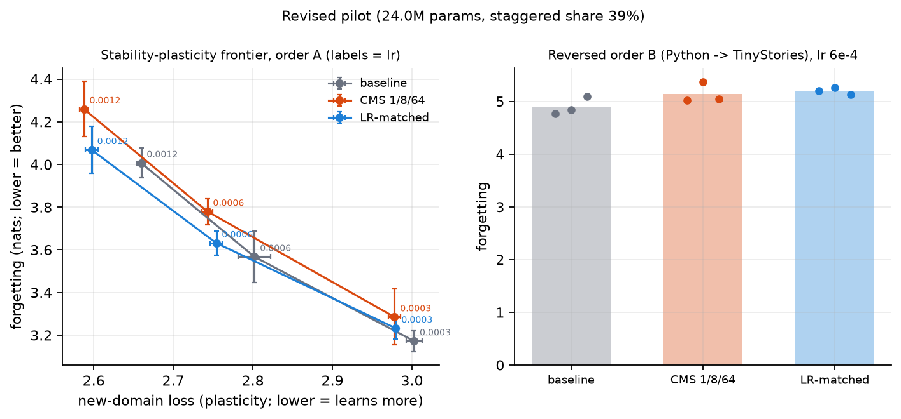
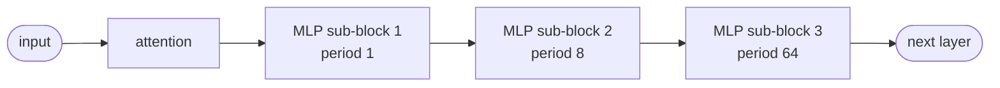
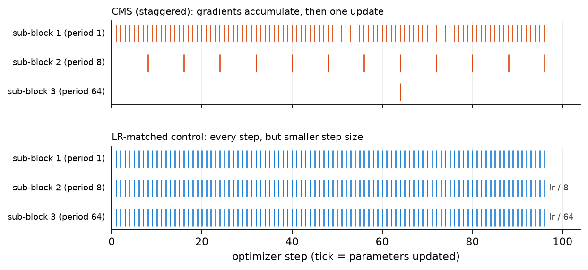
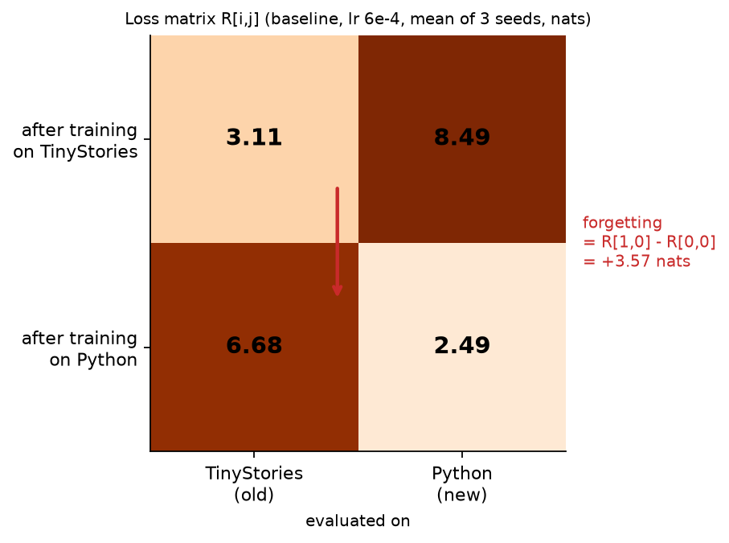
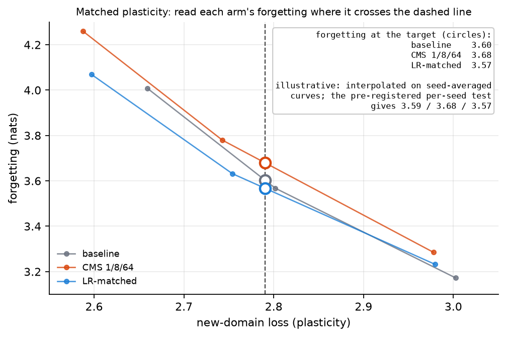
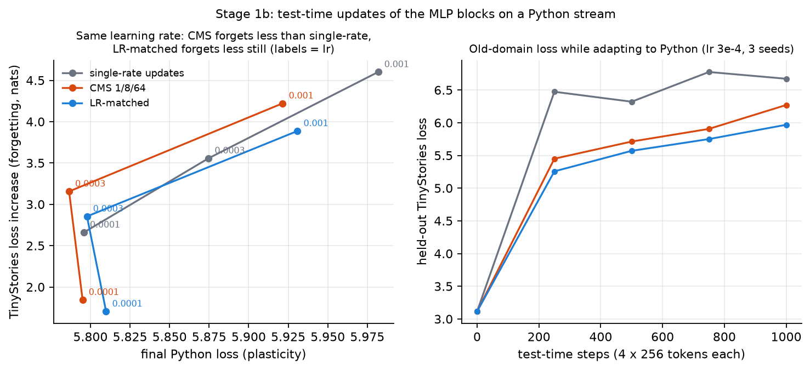
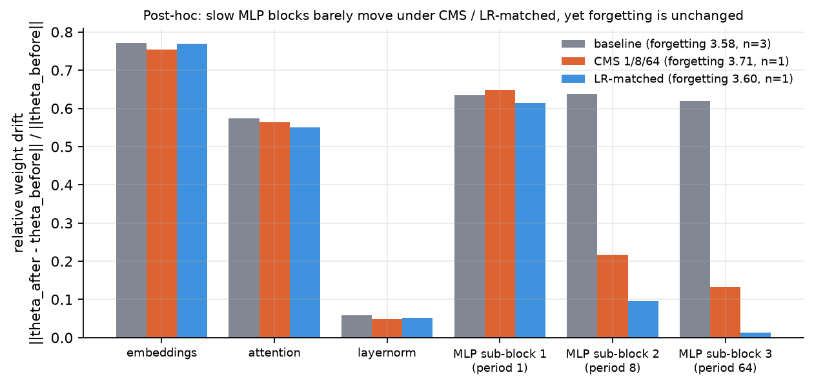
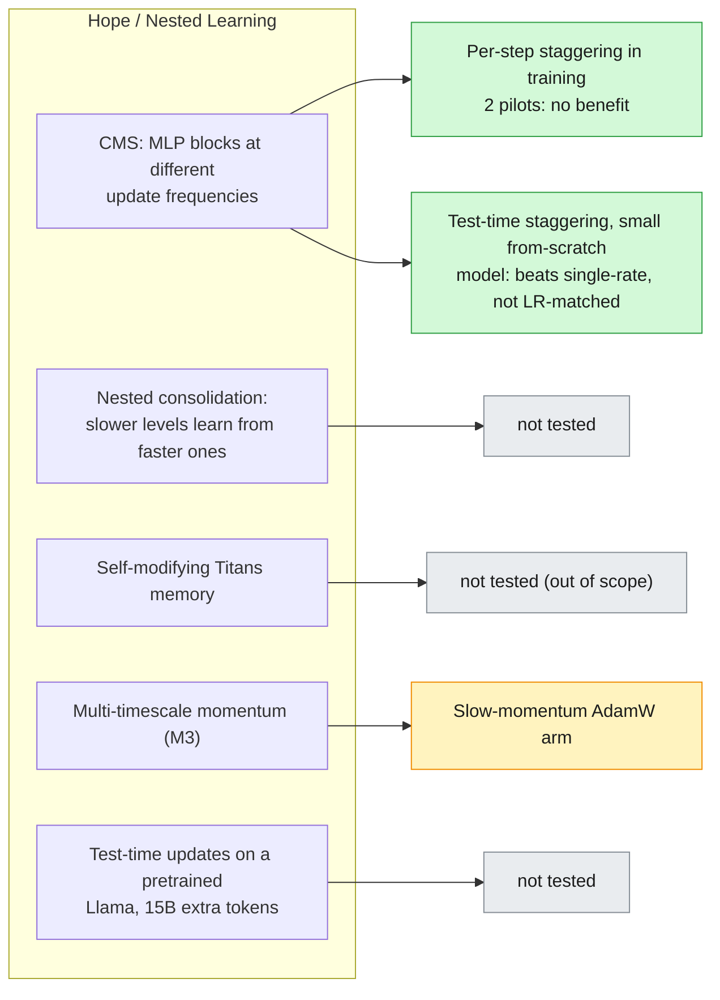

# catadye

**Does staggering update frequencies reduce catastrophic forgetting?**
A pre-registered, small-scale test of an idea from Google's [Nested Learning](https://arxiv.org/abs/2512.24695) paper
(the Hope architecture), built to report a negative result as readily as a positive one.

> **Result so far: no.** In a small transformer trained on one domain after another, MLP blocks that update
> every 1 / 8 / 64 steps forget no less than a normal model once you compare at the same amount of learning.
> They behave like a smaller learning rate. Two pilots, both negative. A test-time probe, closer to what the
> paper actually does, shows the direction the paper claims (staggering forgets less than single-rate updates)
> but a plain learning-rate control forgets even less.



## The question

Nested Learning's Continuum Memory System (CMS) chains MLP blocks that update at different frequencies.
The authors report less forgetting but say it is "not solved in general", and Google released no code.
I could not find an independent test of whether the *frequency staggering itself* is what helps, so this repo runs one.

Every arm has the same architecture, so parameters and forward FLOPs match. Arms differ only in **how often each
sub-block updates**:





The **LR-matched control** is the comparison that matters. Under AdamW, updating a block every *k* steps moves it
about 1/*k* as far as updating it every step, so any gain from staggering could just be a smaller learning rate.
The control uses the same blocks at `lr/k`, updated every step.

## How forgetting is measured

Train on domain 1 (TinyStories), then domain 2 (Python), evaluating both after each. **Forgetting** is how much
the domain-1 loss rises after training on domain 2. Slower learning forgets less but also learns less, so arms are
compared at the same new-domain loss: each arm runs at three learning rates, which traces a line, and forgetting
is read off each line at a common point.

<table>
<tr>
<td width="46%"></td>
<td width="54%"></td>
</tr>
</table>

## Results

24.0M-parameter model, staggered blocks are 39% of the parameters, 3 learning rates, 3 seeds.
Forgetting in nats at matched new-domain loss (2.79); lower is better.

| Arm | Forgetting | Difference vs baseline [95% CI] |
|---|---|---|
| Baseline | 3.59 ± 0.16 | |
| CMS 1 / 8 / 64 | 3.68 ± 0.06 | +0.09 [-0.17, +0.25] |
| LR-matched control | 3.57 ± 0.05 | -0.03 [-0.16, +0.09] |

- CMS vs LR-matched control: +0.11 [-0.01, +0.18]. Both CIs include zero: no detectable difference.
- The pre-registered bar was a 10% reduction with the CI below zero. It was not met, so the pre-registered gate
  selects the short version of the plan.
- Reversing the domain order gives the same picture. The first pilot (16.1M params) was also negative.
- Full numbers: [docs/RESULTS.md](docs/RESULTS.md).

## Test-time probe (Stage 1b)

Closer to the paper: take a model trained on TinyStories, stream ~1M tokens of Python through it, and update only the
MLP blocks as the tokens arrive. Same blocks, three update rules: every block every step, CMS staggering (1 / 8 / 64
steps), and the LR-matched control.



Forgetting in nats, final Python loss in brackets (3 seeds):

| lr | single-rate | CMS 1/8/64 | LR-matched |
|---|---|---|---|
| 1e-4 | 2.66 (5.80) | 1.84 (5.80) | 1.70 (5.81) |
| 3e-4 | 3.56 (5.88) | 3.16 (5.79) | 2.85 (5.80) |
| 1e-3 | 4.60 (5.98) | 4.22 (5.92) | 3.89 (5.93) |

- **Pre-registered readout: both hypotheses fail.** CMS vs single-rate: -5%, CI spans zero. CMS vs LR-matched: CMS
  forgets 21% *more*, CI excludes zero.
- That readout is unreliable here: Python loss barely changes with learning rate, so the matched-plasticity curves are
  nearly vertical. Comparing at the same learning rate (**post-hoc**), CMS forgets 8-31% less than single-rate updates,
  but the LR-matched control forgets 8-11% less than CMS at every learning rate.
- So staggering helps relative to updating everything at once, and a smaller step for the deeper blocks does at least
  as well. This is not Hope's full mechanism: no nested consolidation, and the base model was not trained with
  staggered blocks. Even the lowest learning rate here forgets 2.7 nats, so the grid never reaches a mild regime.

## Why is there no effect? (post-hoc, exploratory)

I measured how far each part of the model moves while it learns the second domain. The staggering works as
intended: under CMS and the LR-matched control the two slow MLP blocks barely move. Forgetting is unchanged anyway,
so it is not carried by those blocks. The parts that update every step (embeddings, attention, the first MLP block)
move 55-77% in every arm and plausibly carry it.



This is observational and was not pre-registered; CMS and LR-matched have one seed each. I did not run the
counterfactual (freeze those parts and retrain). Details, and a reproducibility limit I found (same-seed reruns
differ by up to ~0.1 nats in forgetting), are in [docs/RESULTS.md](docs/RESULTS.md).

## What this does and does not show

It shows that **per-step update-frequency staggering during training is not the active ingredient** at this scale.
It does **not** test Hope itself. Green = tested here, amber = planned or running, grey = not tested.



Limits: 3 seeds, one period set (1/8/64), small from-scratch models, no replay baseline yet; same-seed reruns differ by up to ~0.1 nats.

## Status

| Stage | State |
|---|---|
| Plan and pre-registration | done, tag `prereg-v1` |
| Pilot 1 (16.1M params) | done, negative |
| Pilot revision 1: bigger staggered share, learning-rate sweep, order check | done, negative, tag `prereg-pilot-rev1` |
| Stage 1b: test-time probe | done (`prereg-stage1b`): declared hypotheses fail; post-hoc per-lr result above |
| Post-hoc diagnostics: where does the forgetting live? | done, exploratory (drift figure above) |
| Main grid (replay, EWC, slow momentum), LoRA stage | not started |

Every stage's design was committed and tagged **before** its runs. The criteria, thresholds and deviations are in
[docs/PREREGISTRATION.md](docs/PREREGISTRATION.md).

## Run it

Tested on Windows with an RTX 3050 (4 GB). A pilot run takes about 8 minutes.

```bash
python -m venv .venv
.venv/Scripts/pip install torch --index-url https://download.pytorch.org/whl/cu124
.venv/Scripts/pip install numpy tiktoken pyyaml scipy matplotlib pytest

.venv/Scripts/python -m pytest                    # unit tests
.venv/Scripts/python scripts/run_pilot_rev.py     # revised pilot, 36 runs
.venv/Scripts/python scripts/analyze_pilot_rev.py # pre-registered readout
.venv/Scripts/python scripts/make_figures.py      # regenerate every figure
```

Data is streamed over HTTP on first use and cached in `data/` (git-ignored).

```
src/catadye/    model, staggered updates, training loop, metrics, test-time module
scripts/        runners, readouts, figures      configs/   per-experiment YAML
results/        raw per-run JSON (never edited)   docs/     pre-registration and results log
tests/          unit tests
```
