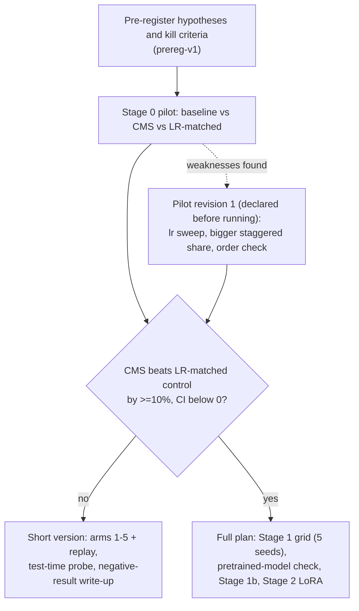
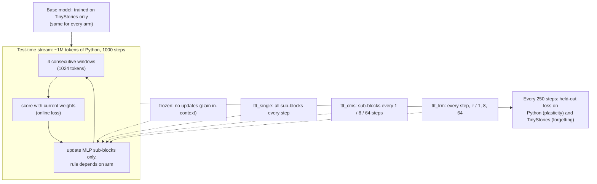

# Pre-registration, declarations and deviations

Moved verbatim from the README on 2026-11-12 (text unchanged; git history and the tags `prereg-v1`,
`prereg-pilot-rev1`, `prereg-stage1b` show each section as it stood before the runs it governs).
Results are in [RESULTS.md](RESULTS.md).

## Study flow

## Stage 1b at a glance (test-time probe)

---

## Pre-registration (written before any experiment is run)

Status: PRE-REGISTERED. Changes after the first run go in the Deviations log at the bottom, with
a date and reason; the original text is never edited.

### Hypotheses
- **H1** CMS (periods 1/8/64) reduces forgetting versus the baseline at matched plasticity.
- **H2** CMS reduces forgetting versus the LR-matched control (blocks at lr, lr/8, lr/64 updated
  every step). This separates "update frequency" from "smaller effective step".
- **H3** Slow-momentum AdamW reduces forgetting versus plain AdamW.
- **H4** CMS and slow momentum interact (2x2 interaction term differs from zero).

### Primary metric
Forgetting at matched plasticity. For each arm, sweep the shared learning rate scale on domain 1
only; compare arms at equal new-domain (final-domain) eval loss, via the stability-plasticity
frontier (mean loss increase on earlier domains versus new-domain loss). Secondary: loss matrix
R[i,j] (domain j after training on i), backward transfer, forward transfer, final average loss.
Cost: wall-clock, peak VRAM, tokens/s.

### Minimum effect of interest
A 10% relative reduction in mean earlier-domain loss increase, with the 95% CI excluding 0 and
new-domain loss no more than 2% worse. Smaller differences are reported as "no practical effect".

### Statistics
Seed-paired differences, bootstrap 95% CIs (10,000 resamples), Holm correction across the planned
comparisons H1-H4. A difference whose CI includes 0 is called "within noise".

### Matching
Every arm has identical parameter count and forward FLOPs (each MLP is a 3-block chain in every
arm). Update overhead is reported honestly. Learning rates come from a pre-declared sweep on domain
1 only; nothing is tuned on forgetting metrics.

### Stage 0 pilot and kill criteria
~10M-param GPT, TinyStories then Python code, 3 arms (baseline, CMS 1/8/64, LR-matched), 3 seeds.
The "frequency per se" hypothesis is falsified at pilot scale if (a) CMS does not reduce
domain-1 loss increase versus baseline at matched domain-2 loss, or (b) CMS is within seed noise of
the LR-matched control. The study continues either way, framed around whichever outcome holds.

**Decision gate:** if CMS differs from the LR-matched control beyond seed noise, run the full plan
(Stage 1 grid, Model B check, Stage 1b probe). Otherwise run the short version (arms 1-5 plus
replay, Stage 1b, a negative-result write-up) and skip Stage 2.

### Arms (Stage 1)
1 baseline; 2 CMS 1/8/64; 3 slow-momentum AdamW; 4 CMS + slow momentum; 5 LR-matched control;
6 replay 10%; 7 EWC; 8 joint training (upper bound); 9 in-context-learning baseline (eval only).

## Deviations log
- 2026-11-11: pilot model has 16.1M parameters, not ~10M (GPT-2 vocab embeddings are ~13M of that).
- 2026-11-11: each batch of 16 is run as 2 micro-batches of 8 (identical gradient) to fit 4 GB VRAM.
- 2026-11-11: raw data streamed over HTTP; `datasets`/pandas/pyarrow are blocked on the dev machine.
  Pilot domains: TinyStories (first documents of the train file) then Python code (codeparrot-clean-valid).
- 2026-11-12: the planned reproducibility check (same seed gives the same loss matrix) fails on this GPU:
  same-seed reruns differ by up to ~0.1 nats in forgetting (non-deterministic kernels). Logged as a limitation;
  see docs/RESULTS.md, post-hoc diagnostics.

## Pilot revision 1 (declared 2026-11-12, BEFORE any revised run)

Motivation: the first pilot was negative but had three weaknesses (below). This revision addresses
them; it is not a search for a positive result. The first pilot's numbers stay in the Results log
and in `results/pilot/`. **The revised pilot is the final input to the pre-registered decision gate;
no further pilot revisions will be made to rescue the hypothesis.**

Changes (all fixed here, before running):
1. Staggered share: 6 layers, each sub-block a full 4x MLP (was 4 layers, 4/3x), taking the share of
   parameters in staggered sub-blocks from ~13% to ~40%. Periods stay 1/8/64.
2. Matched plasticity done properly: every arm runs at 3 learning rates (3e-4, 6e-4, 1.2e-3).
3. Order check: reversed domain order (Python -> TinyStories) for all arms at lr 6e-4.
Seeds 0-2 as before. Runs: 27 (order A) + 9 (order B) = 36, ~11 min each.

Revised readout (fixed now): for each arm and seed, forgetting is linearly interpolated as a
function of new-domain loss across the 3 learning rates, and evaluated at a common new-domain loss
(the median baseline new-domain loss, used only if inside every arm's range; otherwise reported as
"no overlap"). Seed-paired bootstrap CIs of arm differences at that point. Criteria (a) and (b) and
their thresholds (>=10% reduction, CI below 0) are unchanged. Raw per-lr differences are also
reported. Order B is reported as a robustness check, not used in the gate.

## Stage 1b: test-time probe (declared 2026-11-12, BEFORE any Stage 1b run)

Why: the paper's CMS updates *at test time* on the token stream; the training-step version tested
above does not. This probe is the closest toy-scale analogue of the paper's mechanism. It is
exploratory and reported separately from the training-time pilots.

Setup (fixed here):
- Base models: 24.0M-param GPT (pilot-revision-1 architecture), trained on TinyStories only, 2000
  steps, lr 6e-4, seeds 0-2, one shared base per seed for every arm. The base is *not* co-trained with
  staggered blocks, so only the test-time update rule differs between arms.
- Stream: the first ~1.02M tokens of Python code (never seen by the base), consumed in order as 1000
  steps of 4 consecutive 256-token windows. Each step is scored first, then used for one update.
- Only MLP sub-blocks update at test time (everything else frozen); AdamW, no weight decay, constant lr,
  grad clip 1.0. Arms: `frozen` (plain in-context baseline, no updates); `ttt_single` (all sub-blocks
  update every step); `ttt_cms` (sub-blocks update every 1/8/64 steps with mean accumulated gradient);
  `ttt_lrm` (every step, lr scaled by 1/1, 1/8, 1/64). Test-time lr in {1e-4, 3e-4, 1e-3}.
- Metrics at steps 0/250/500/750/1000: held-out Python loss (plasticity), held-out TinyStories loss
  (forgetting = loss at end minus loss at step 0), online pre-update stream loss.
- Runs: 3 ttt arms x 3 lrs x 3 seeds + frozen x 3 seeds = 30.
- H5: `ttt_cms` reduces forgetting vs `ttt_single` at matched plasticity. H6: `ttt_cms` reduces forgetting
  vs `ttt_lrm` at matched plasticity. Matched plasticity and thresholds exactly as in Pilot revision 1:
  forgetting interpolated across the 3 lrs as a function of final held-out Python loss, evaluated at the
  median `ttt_single` final Python loss, only if inside every arm's range for every seed (otherwise "no
  overlap"); >=10% relative reduction with seed-paired bootstrap CI below 0. Sanity check: every ttt arm
  must beat `frozen` on final Python loss, else the probe is uninformative.
- Not tested here (stated up front): nested consolidation between levels, a CMS-co-trained base,
  pretrained backbones, 15B-token continual pre-training, the self-modifying memory.

## Stage 1b-low: lower test-time learning rates (declared 2026-11-13, BEFORE any run)

Motivation: at lr 1e-4 (the lowest in Stage 1b) forgetting is still 1.7-2.7 nats, so the grid never reached a mild
regime. Design: identical to Stage 1b (same bases, stream, arms, seeds 0-2) at lr in {1e-5, 3e-5}, results in
`results/ttt_low/`. Exploratory, no gate. Primary readout: at each lr, seed-paired difference in forgetting for
CMS vs single-rate and CMS vs LR-matched, with bootstrap CI; "no effect" if the CI includes 0. Frozen-model numbers
are reused from Stage 1b. Nothing else is tuned.
