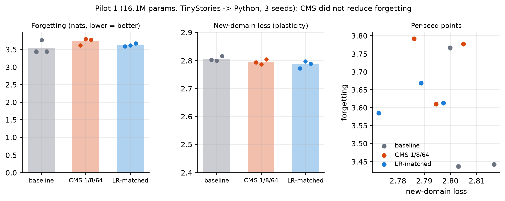
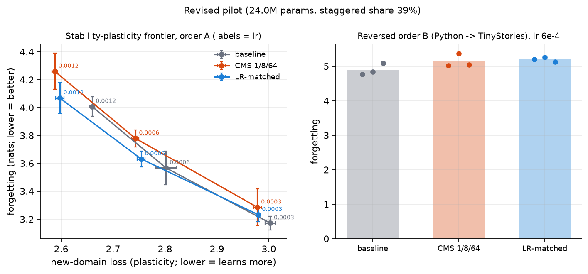

# Results log

Moved verbatim from the README on 2026-11-12. Summary and figures are in the [README](../README.md);
the pre-registration is in [PREREGISTRATION.md](PREREGISTRATION.md). Figures are regenerated from
`results/` by `python scripts/make_figures.py`.

### Stage 0 pilot (2026-11-12) — raw runs in `results/pilot/`, readout via `scripts/analyze_pilot.py`
16.1M-param GPT, TinyStories -> Python, 2000 steps/domain, 3 seeds/arm. Forgetting = rise in
TinyStories eval loss after training on code (nats); lower is better.

| arm | forgetting | new-domain loss | tokens/s | updated fraction/step |
|---|---|---|---|---|
| baseline | 3.549 ± 0.189 | 2.806 ± 0.009 | 35.7k | 1.000 |
| CMS 1/8/64 | 3.726 ± 0.100 | 2.795 ± 0.009 | 36.9k | 0.919 |
| LR-matched | 3.622 ± 0.043 | 2.786 ± 0.013 | 36.7k | 1.000 |

Plasticity was matched (new-domain loss within 1%) in all comparisons.
- CMS vs baseline: forgetting +0.178 nats [+0.025, +0.334], i.e. CMS forgot ~5% **more**.
- CMS vs LR-matched: +0.104 [+0.026, +0.179], ~3% more.
- Pre-registered criteria (a) and (b) both fail: no reduction at all, let alone the 10% minimum.
  Under the kill criteria the "frequency per se" hypothesis is falsified at this scale.

Caveats: 3 seeds (bootstrap has 27 distinct resamples, so CIs are coarse); one learning rate and
one domain order; the staggered sub-blocks are only ~13% of the parameters (embeddings are ~80%),
so the intervention touches little of the model; forgetting is extreme (>3 nats) in this regime.
Per the decision gate, the short version of the plan applies unless the pilot is revised.

### Pilot revision 1 (2026-11-12) — raw runs in `results/pilot_rev/`, readout via `scripts/analyze_pilot_rev.py`
Per-learning-rate means over 3 seeds (new-domain loss, forgetting in nats), order A:

| lr | baseline | CMS 1/8/64 | LR-matched |
|---|---|---|---|
| 3e-4 | 3.002, 3.172 | 2.978, 3.285 | 2.980, 3.232 |
| 6e-4 | 2.802, 3.568 | 2.743, 3.780 | 2.754, 3.632 |
| 1.2e-3 | 2.659, 4.007 | 2.588, 4.260 | 2.597, 4.069 |

The declared interpolation target (median baseline new-domain loss, 2.790) lay inside every arm's
range for every seed, so the matched-plasticity test was valid. Outcome: criteria (a) and (b) fail;
gate = short version. Per the declaration, no further pilot revisions will be made.
Caveats: 3 seeds; one period set (1/8/64); small scale (24.0M params); from-scratch model; no replay.
